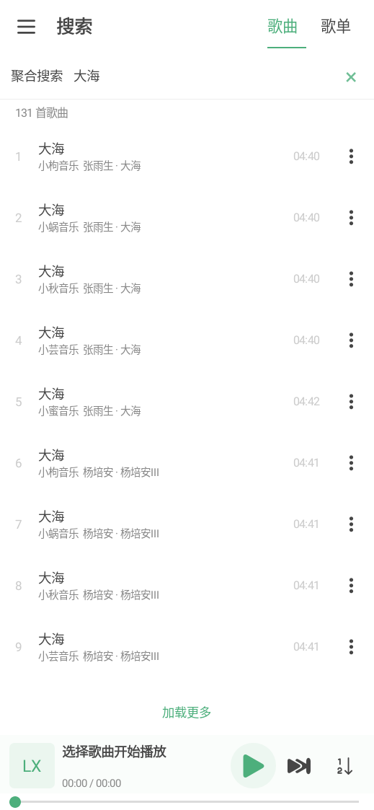

# LX Music 原生 Android

基于 LX Music 迁移的 Kotlin 原生 Android 音乐应用。支持在线与本地音乐、同步歌词、均衡器和本机 K 歌录唱，适配手机和平板。

> 特别说明：不建议在任何渠道进行公开传播，其后果自负。

## 安装与更新

从 [GitHub Releases](https://github.com/savet-save/lx-music-android/releases) 选择 `native-v*` 发布下的 APK。下表为当前源码启用 ABI 拆分后的六种 APK 文件名后缀，完整文件名以 `lx-music-native-v版本号` 开头。已发布的 [0.9.21](https://github.com/savet-save/lx-music-android/releases/tag/native-v0.9.21) 提供三种普通版 APK。

| 设备架构 | 普通版 | 内置人声分离模型版 |
| --- | --- | --- |
| 64 位 ARM（`arm64-v8a`） | `-armv8.apk` | `-armv8-with-model.apk` |
| 32 位 ARM（`armeabi-v7a`） | `-armv7.apk` | `-armv7-with-model.apk` |
| 通用（ARM、x86、x86_64） | `-all.apk` | `-all-with-model.apk` |

普通版可在应用内按需下载模型，内置版从 APK 加载模型。设备架构不确定时可选择通用包。

当前源码的应用内更新会保持现有 APK 的模型类型，并按设备支持的架构选包。下载过模型的普通版仍使用普通版更新。缺少匹配的架构包时选用同类型的通用包。应用 ID 为 `cn.toside.music.nativeapp`，覆盖升级需匹配包名和签名。原 LX Music 应用的歌单可通过备份或同步迁入。

早期内置模型版需手动覆盖到支持此规则的内置版一次，之后即可沿内置版更新。

## 主要特点

- **手机和平板播放页**支持圆形旋转封面，暂停时保留角度。采用主题色的光环随播放音量变化，无需麦克风授权。手机可切换封面和歌词，平板可并排显示。播放与歌词设置、定时停止和歌曲操作集中在右上角的「更多」菜单。
- **播放和下载**支持队列编辑、播放历史、倍速、音频缓存和离线重播，以及音频、歌词和封面下载。播放队列与播放历史使用独立页面，bilibili 原始音频可另存为 MP3。均衡器可调整各频段增益并查看曲线，频段和增益范围取决于设备。
- **音乐发现**提供五平台聚合搜索、歌单、排行榜、推荐、搜索历史和热搜。启用「B站音乐」后可搜索 bilibili 视频并播放音频。评论和回复可独立查看，单张配图按比例展示，多张配图以网格显示，点击可查看大图。
- **多音源与歌词**支持从本地或链接导入脚本，最多同时启用 3 个音源并按优先级尝试。歌词支持逐字、译文、罗马音和桌面歌词，bilibili 可选择优先视频字幕或匹配歌词。
- **K 歌录唱**支持本机人声分离、伴奏缓存、原唱切换、同步录音和混音试听。可裁剪录音、调整伴奏与人声音量及对齐方式，支持基础降噪。
- **本地音乐与个性化**支持歌曲信息编辑、歌单与不喜欢列表双向同步、歌单备份恢复、16 套主题，以及简体中文、繁体中文和英文界面。

## 使用需求

- 手机和平板需运行 Android 9（API 28）或更高版本。首次使用需阅读并同意应用内的项目使用协议。
- 在线搜索需要联网，播放或下载未缓存的在线音频还需可用音源。新安装默认启用「野花🌷」。bilibili 的部分内容和字幕需要登录。
- 使用本地媒体库时按提示授权音频读取。桌面歌词需悬浮窗权限，K 歌录音需麦克风权限，Android 9 下载文件时需存储写入权限。
- 数据同步需准备兼容 LX v4 的同步服务地址及连接码，在「数据同步」中连接。

## K 歌与人声分离

1. 选择歌曲，在播放页点击「K 歌」。伴奏准备显示百分比，同一歌曲和分离配置匹配时可复用伴奏缓存。
2. 录音时可同步看歌词、暂停、继续或提前结束，歌曲结束后自动停止。录完可拖动试听进度，也可在试听时实时调整伴奏和人声音量。
3. 保存后，混音以 WAV 形式存入应用私有目录。可在「我的列表」或 K 歌页打开「我的 K 歌歌单」，播放、查看录制时间等信息、导出或分享。

「设置 → 人声分离」可下载约 30 MB 的 MDX-Net（UVR 9703）模型，也可从 K 歌页按需下载。内置版可离线加载模型，本地分离使用 ONNX Runtime。设置中可调整消除强度、分块重叠和推理线程，修改在下次准备伴奏时应用。模型未安装、关闭、内存不足或分离失败时，可使用基础伴奏。人声残留与处理耗时取决于原音和设备。

## 界面预览

搜索页展示“大海”的聚合搜索结果，播放页使用示例歌曲展示界面。

### 手机

| 搜索页（聚合搜索“大海”） | 播放页 |
| :---: | :---: |
|  |  |

### 平板

| 搜索页（聚合搜索“大海”） | 播放页 |
| :---: | :---: |
|  |  |

## 数据安全

- **本地数据**：歌单、设置和播放历史保存在本机。搜索、播放、下载等联网功能会向对应平台和音源服务发送必要的查询及歌曲信息。
- **登录凭据**：bilibili SESSDATA 和网易歌单访问凭据通过 Android Keystore 加密保存在本机，可在设置中清除；bilibili 凭据不会提供给自定义音源脚本或音频 CDN。
- **第三方服务**：仅在连接同步服务后同步歌单和不喜欢列表。请使用可信任的音源脚本及同步服务，第三方服务会接收相应请求或同步数据。
- **备份与恢复**：卸载应用或清除应用数据前，请先导出歌单备份。备份文件含歌单及歌曲信息，请妥善保管，恢复时核对合并或覆盖选项。
- **K 歌录音**在本机进行录制、人声分离和混音。需要单独保存录音作品时，可在「我的 K 歌歌单」使用导出功能。

## 构建与验证

使用 JDK 17、Android SDK 36、NDK 27.2.12479018 和 CMake 3.22.1。在仓库根目录运行以下 Gradle 任务。

```powershell
.\gradlew.bat :app:assembleDebug :app:testDebugUnitTest :app:lintDebug
```

普通正式版使用 `:app:assembleRelease`。内置模型版使用 `:app:assembleModelRelease`，并通过 `-PnativeBundledMdxModel` 指定本地 ONNX 权重文件。两种构建均可加 `-PnativeSplitApks=true` 生成 ARM 和通用附件。模型权重在构建时校验并嵌入，签名配置、模型下载地址及发布步骤见 [构建与发布](RELEASING.md)。

## 更多说明

[使用与开发说明](DEVELOPMENT.md) · [常见问题](FAQ.md) · [构建与发布](RELEASING.md) · [验证记录](VALIDATION.md)

## 来源与许可

基于 [lyswhut/lx-music-mobile](https://github.com/lyswhut/lx-music-mobile)，保留原项目的 [Apache 2.0 许可](LICENSE)、资源及使用协议。K 歌使用的 [ONNX Runtime](app/src/main/assets/licenses/ONNX-Runtime-MIT.txt) 与 [Ultimate Vocal Remover](app/src/main/assets/licenses/Ultimate-Vocal-Remover-MIT.txt) 许可随应用附带。第三方组件许可也可在应用「关于与版本」中查看。
