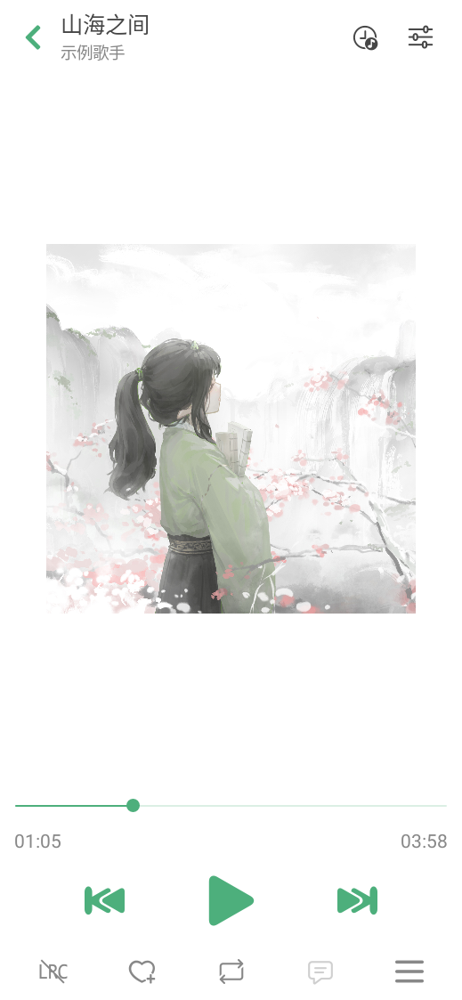
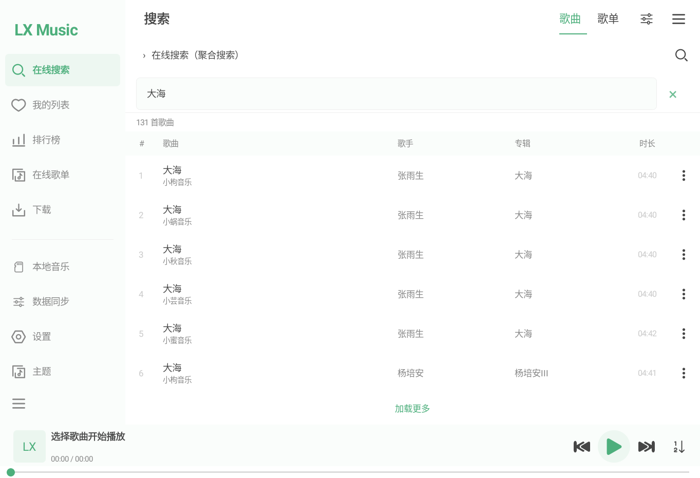
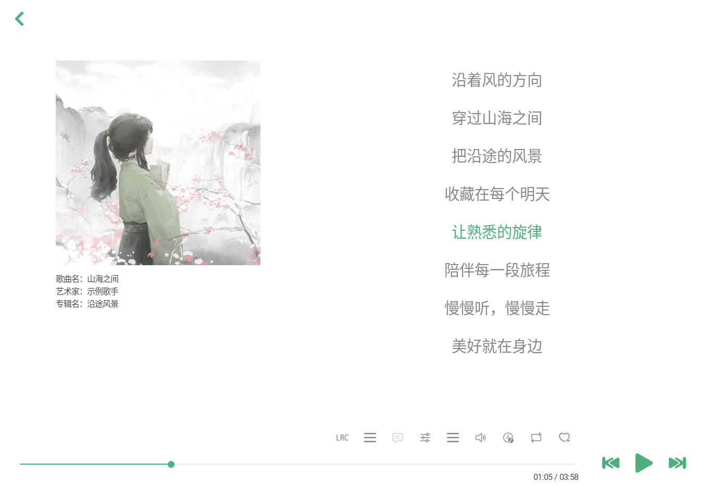

# LX Music 原生 Android

基于 LX Music 迁移的原生 Kotlin 音乐应用，适配手机和平板。

> 特别说明：不建议在任何渠道进行公开传播，其后果自负。

## 主要特点

- **手机 / 平板自适应**：手机侧边导航与大封面播放页，平板常驻侧栏、封面与歌词并排显示。
- **音乐发现**：五平台聚合搜索，支持歌曲、歌单、排行榜、推荐和评论；启用“B站音乐”后可搜索 bilibili 视频并播放音频。
- **多音源管理**：支持本地和链接导入，最多同时启用 3 个音源，自定义优先级，失败后依次尝试。
- **播放与下载**：播放队列、倍速、定时停止、音频缓存和离线重播，支持下载音频、歌词及封面，bilibili 原始音频可另存为 MP3。
- **歌词与字幕**：逐字歌词、译文、罗马音和桌面歌词；bilibili 可选择优先视频字幕或优先匹配歌词。
- **本地音乐与数据同步**：歌曲信息编辑、歌单管理、备份导入导出，支持歌单与不喜欢列表双向同步。
- **个性化设置**：16 套主题，简体中文、繁体中文和英文，支持字号、歌词排版及左右导航设置。

## 使用需求

- **系统**：Android 9（API 28）及以上，支持手机和平板。
- **网络与音源**：在线搜索需要联网；播放或下载未缓存的在线音频还需启用可用音源，新安装默认启用“野花🌷”。使用 bilibili 需启用“B站音乐”，部分内容和字幕需要登录。
- **功能权限**：访问本地媒体库时按提示授权音频读取，桌面歌词需悬浮窗权限；Android 9 下载文件时需存储写入权限。
- **数据同步**：需准备兼容 LX v4 的同步服务地址及连接码，在“数据同步”中连接。
- **首次使用**：阅读并同意应用内的项目使用协议。

自行构建需 JDK 17 和 Android SDK 36，步骤见[使用与开发说明](DEVELOPMENT.md)。

## 界面预览

搜索页展示“大海”的聚合搜索结果，播放页使用示例歌曲展示界面。

### 手机

| 搜索页（聚合搜索“大海”） | 播放页 |
| :---: | :---: |
|  |  |

### 平板

| 搜索页（聚合搜索“大海”） | 播放页 |
| :---: | :---: |
|  |  |

## 数据安全

- **本地数据**：歌单、设置和播放历史保存在本机。搜索、播放、下载等联网功能会向对应平台和音源服务发送必要的查询及歌曲信息。
- **登录凭据**：bilibili SESSDATA 和网易歌单访问凭据通过 Android Keystore 加密保存在本机，可在设置中清除；bilibili 凭据不会提供给自定义音源脚本或音频 CDN。
- **第三方服务**：仅在连接同步服务后同步歌单和不喜欢列表。请使用可信任的音源脚本及同步服务，第三方服务会接收相应请求或同步数据。
- **备份与恢复**：卸载应用或清除应用数据前，请先导出歌单备份。备份文件含歌单及歌曲信息，请妥善保管，恢复时核对合并或覆盖选项。

## 更多说明

[使用与开发说明](DEVELOPMENT.md) · [常见问题](FAQ.md) · [构建与发布](RELEASING.md) · [验证记录](VALIDATION.md)

## 来源与许可

基于 [lyswhut/lx-music-mobile](https://github.com/lyswhut/lx-music-mobile)，保留原项目的 [Apache 2.0 许可](LICENSE)、资源及使用协议。第三方组件许可可在应用“关于与版本”中查看。
